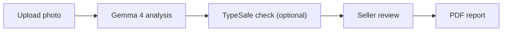

# Disclosure

**Photograph a home's problems. Review the AI's findings. Create a disclosure report.**

Built for **GDG Build with AI x Hacktoberfest 2026: AI for Housing**, Disclosure helps home sellers turn photos of visible problems into a PDF report they review and approve.

**[Try Disclosure](https://disclosure-app-jyruvsvlxa-uk.a.run.app/)** — hosted on Google Cloud Run. No installation required.

**Gemma 4 analyzes the photo. TypeSafe can check the findings. The seller controls the report.** The website connects to Gemma on a private Google Cloud server with a GPU. Developers can also run Gemma on their own computer using Ollama.

> **This tool helps document visible problems. It does not provide a home inspection or legal advice.** Use the report alongside the official disclosure form; it does not replace that form.

## From photo to report

1. **Capture:** take or upload a photo of a visible problem from a phone or computer.
2. **Analyze:** Gemma 4 suggests a description and problem type, how serious the problem is, how soon it needs attention, and how confident the AI is.
3. **Review:** confirm, correct, or remove each finding. If enabled, TypeSafe checks the AI's text before you review it.
4. **Export:** download a PDF with confirmed findings, photos, grades, repair cost ranges, and suggestions for professional help.

## How we use Gemma 4

**Gemma 4 analyzes photos for Disclosure.** It receives a photo and instructions about housing problems, then returns a finding in a format the app can read.

1. **Prepare the image.** [Image processing](app/images.py) rotates the photo as needed, removes details such as GPS location and camera information, and saves it as a JPEG with a longest side of at most 1024 pixels.
2. **Send the photo to Gemma.** [OllamaAnalyzer](app/inference/ollama_analyzer.py) sends the photo, encoded as base64 text, and the instructions to Ollama's `/api/chat`. Requests use temperature `0` to limit randomness. A setting controls how long the model stays loaded between requests. The same code connects to Ollama locally or on our private Cloud Run GPU service. Recorded tests use **`gemma4:e4b`**.
3. **Describe the problem, then choose a category.** Prompt **v3.2** asks Gemma for a short title and a description of what it can see, in at most 20 words. It also asks for the problem type, severity from **1–5**, urgency, confidence, image quality, and whether the category matches the description. The instructions focus on visible damage and distinguish a blurry subject from a clear subject with a blurred background.
4. **Check the response format.** The [instructions and required JSON format](app/inference/prompts.py) use [27 problem categories plus `unclear`](assets/defect_taxonomy.json). The app checks category IDs, allowed values, and severity limits, cleans up the title, and limits description length. If the response is invalid, the app tries once more before marking the finding as unclear.
5. **Take a second look when needed.** When TypeSafe checks are enabled, a category that conflicts with Gemma's description can trigger another analysis of the same photo. The new instructions explain the conflict. The revised finding must pass the text check, and its confidence cannot be higher than medium.

All requests to Gemma go through [`DefectAnalyzer`](app/inference/analyzer.py). This keeps photo analysis separate from grading, repair cost lookup, and report creation.

### What the AI does and does not do

| Responsibility | How Disclosure handles it |
|---|---|
| Analyze the photo | Gemma describes what it sees and suggests a category, severity, urgency, image quality, and confidence level |
| Check the description | If enabled, TypeSafe checks whether the category and severity match Gemma's words and flags cost or legal language |
| Calculate grades | The app applies the severity × urgency rule explained below |
| Look up repair cost ranges | A separate table supplies example ranges; **these prices are demo data, not verified estimates** |
| Decide what enters the report | The seller confirms each finding and can edit or remove it |

The AI cannot certify that a home is safe or decide what the seller must disclose by law. TypeSafe checks text only. The AI's confidence level helps guide review; it is not a professional assessment.

## TypeSafe verification

TypeSafe's Jev model provides an optional **second opinion on the text** through [`Judge`](app/inference/judge.py). It returns scores and category choices that the app uses to update a finding's status and messages.

- **Check the category:** compare Gemma's category with its title and description. A conflict triggers a second look at the photo. After that, the app may correct the category using the text or use a descriptive title instead.
- **Check the severity:** lower confidence when the severity does not match the description. A low-confidence finding is marked unclear and gets no grade.
- **Limit confidence after corrections:** a second-look result cannot have confidence above medium. Changing a category based on text never raises confidence.
- **Check cost and legal language:** replace flagged text with wording from the problem category list. The app also checks for dollar signs and numbers, even when TypeSafe is unavailable.
- **Handle failed checks:** keep Gemma's finding and record the check's status if verification fails. When verification is not configured, `NullJudge` skips network requests.
- **Check photo test results:** the [photo test script](scripts/run_test_set.py) can ask TypeSafe whether Gemma's description includes the expected visible details and matches the expected problem type.

These checks run in both the backend worker for saved sessions and `/api/analyze`, which the React interface uses. Jev does not write report text. The seller reviews and approves the findings.

To enable these checks, add these settings to `.env` and restart the backend. Git ignores this file, so it is not committed to the repository.

```dotenv
DISCLOSURE_TYPESAFE_URL=<your TypeSafe API base URL>
TYPESAFE_API_KEY=<your API key>
DISCLOSURE_TYPESAFE_MODEL=jev-latest
DISCLOSURE_JUDGE_VERIFY=1
DISCLOSURE_JUDGE_CLASSIFY=0
```

Both the URL and API key are required. See [`.env.example`](.env.example) for settings, [verification tests](tests/test_verify.py) for the decision rules, and [experiment notes](docs/decisions.md#typesafe-text-judge-jev) for model comparisons and the score cutoffs used by the checks.

## How the app works



The **website runs on Google Cloud Run**. Its Python backend uses FastAPI and connects to Gemma 4 through Ollama on a private GPU service. TypeSafe can check Gemma's text. The app calculates grades and looks up repair costs. The seller confirms every finding included in the report.

## The grading rule

**Risk = severity × urgency.** Severity ranges from **1–5**. Urgency is scored as follows: needs immediate attention **4**, within 30 days **3**, within a year **2**, and appearance only **1**.

| Risk | Letter | Label |
|---|---|---|
| 1–3 | A | Minor |
| 4–6 | B | Moderate |
| 7–10 | C | Serious |
| 11–15 | D | Urgent |
| 16–20 | F | Critical |

The AI's confidence affects how the grade appears: **high** shows one letter, **medium** shows that letter and the next worse grade, and **low** shows no grade and recommends a licensed home inspector.

> The overall grade is the worst grade among confirmed, graded findings. It is never an average.

## Safety checks

- **Blurry or non-house photo:** ask for a new photo and show no grade when flagged by the model.
- **Low confidence or unclear finding:** show no grade and recommend a licensed home inspector.
- **D or F grade:** recommend an assessment by a licensed professional who handles that type of problem.
- **Invalid AI response:** retry once, then mark the finding unclear. Do not display a response the app cannot read.
- **Time limit:** offer a Retry button if analysis takes too long. The default limit is 120 seconds per AI request.
- **Model unavailable:** show a startup message with the command to start Ollama or download the selected model.
- **Seller approval:** include only confirmed findings. In the default app, editing a finding requires the seller to confirm it again.
- **Disclaimer:** show the tool's limits at the start, during review, and on every PDF page.

## Privacy

- **Photo details removed:** before analysis, photos are resized and saved without GPS location, timestamps, or camera information.
- **Cloud analysis:** the website and model service run on Google Cloud. Photos with those details removed are sent to the private Gemma service for analysis. That service has no app feature for storing photos.
- **TypeSafe receives text only:** Jev receives Gemma's description, title, other finding fields, and relevant details from the category list or test examples. It does not receive images, session ZIP codes, or recipient email fields. Descriptions may include details visible in the photo. We do not claim that TypeSafe deletes all data after processing.
- **Session storage:** the web interface saves session photos, findings, and details in the browser's `localStorage`. “Delete this session” clears it from that browser; downloaded or emailed copies remain separate. The standalone Python interface saves sessions under `data/` on the computer running the backend.
- **Optional email:** email delivery through SMTP is off until configured. If you send a report, the email provider receives the report and recipient address. The app does not save the uploaded attachment. It holds recipient addresses in temporary server memory to limit how often reports can be sent.
- **Limited data collection:** the default app has no accounts or analytics. It does not automatically hide faces or addresses visible in photos.

The [network test](tests/test_no_network.py) checks selected source files for external URLs written directly in the code. Service addresses are set through environment variables.

## Accessibility

The default interface includes labeled controls, a link to skip to the main content, and a visible highlight for keyboard navigation. When the screen changes, focus moves to its heading. Screen readers receive status updates and progress information. Grades use letters and text as well as colors. Controls are at least 44 pixels tall.

## Measured speed

| Measurement | Recorded result | Scope |
|---|---|---|
| Time to analyze one photo | **7.4 seconds median** (middle result), 5.4–10.2 seconds range | `gemma4:e4b`, prompt v3.2, 17-photo test; does not include later TypeSafe scoring or live checks |
| Photos processed with the GPU model already loaded | **17 photos in 62 seconds**, **16.3 photos/minute** | Separate Cloud Run L4 test with four workers; all 17 analyses succeeded; measures the model service only |

See [full test results](docs/test-results.md) and [Cloud Run measurements](docs/gate0.md#cloud-run-gpu-us-east4-gemma4e4b) for details.

## How we test changes with photos

We keep **17 example photos with expected answers** and run them through the AI after changes. This helps us catch changes that improve one answer but break another.

For example:

- A roof-damage photo should still be categorized as roof damage.
- A cat photo should still be recognized as something other than a house.
- A blurry photo should still prompt a retake rather than receive a grade.

The [photo list](assets/test_photos/test_photos.csv) includes visible problems, blurry photos, pictures unrelated to housing, and an undamaged room. The [test script](scripts/run_test_set.py) records the expected answer, the actual answer, and how long each photo takes. When configured, TypeSafe also checks whether Gemma's description matches the expected visible details.

Results are saved in a [comparison report](docs/test-results.md), so we can compare versions of the AI instructions using the same examples. These checks test the photo analysis answers. Live checks and second looks have separate [automated tests](tests/test_verify.py) and [experiment notes](docs/decisions.md#typesafe-text-judge-jev). All example photos have licenses that allow reuse, with [credits recorded](assets/test_photos/ATTRIBUTION.md).

## Local development

To use Disclosure, open the [hosted website](https://disclosure-app-jyruvsvlxa-uk.a.run.app/). The commands below are for developers running a separate copy on their own computer. `localhost` addresses in this section refer to that local copy.

### Windows

Requires Python 3.11+, Git, and [Ollama](https://ollama.com/download). Start Ollama before analyzing photos.

```powershell
git clone https://github.com/ben-robles/disclosure
cd disclosure
py -3.11 -m venv .venv
.\.venv\Scripts\python -m pip install -r requirements.txt
ollama pull gemma4:e4b
$env:DISCLOSURE_MODEL = "gemma4:e4b"
.\run.ps1
```

Open **http://localhost:8000** for your local copy. Add `-Lan` to the final command to use the app from a phone on the same trusted Wi-Fi network.

### macOS / Linux

From the cloned repository, using Python 3.11+:

```sh
python3 -m venv .venv
.venv/bin/python -m pip install -r requirements.txt
ollama pull gemma4:e4b
DISCLOSURE_MODEL=gemma4:e4b .venv/bin/python -m uvicorn app.main:create_app --factory --host 127.0.0.1 --port 8000
```

### Try the workflow without a model

```sh
.venv/bin/python -m tests.dev_server
```

On Windows, use `.\.venv\Scripts\python -m tests.dev_server`. Open **http://localhost:8001**. This mode runs the real app with preset AI responses so you can try the interface and reports.

### React interface

Python serves the default HTML/CSS/JavaScript app in `static/`; it does not require Node.js. To run the separate React interface, start the Python backend, then run `npm install` and `npm run dev` from `frontend/`.

Vite forwards `/api` requests to port 8000. The React interface stores sessions in browser `localStorage`, queues photos for analysis, and creates PDFs. Use `VITE_MOCK_ANALYZER=1` for preset AI responses. Both interfaces use the backend's TypeSafe checks.

### Configuration

Set environment variables before starting the backend, or add them to `.env`, which Git ignores. Variables already set in the running environment override values in `.env`.

| Setting | Purpose |
|---|---|
| `DISCLOSURE_MODEL` | Name and version of a downloaded model, such as `gemma4:e4b` |
| `DISCLOSURE_OLLAMA_URL` | Address of local Ollama, or `http://localhost:9090` when connecting through a Cloud Run proxy that handles authentication |
| `DISCLOSURE_OLLAMA_TOKEN` | Optional Google Cloud authentication token for a direct connection; leave empty when using the proxy |
| `DISCLOSURE_WORKERS` | Number of backend workers; match Ollama's `OLLAMA_NUM_PARALLEL` |
| `DISCLOSURE_KEEP_ALIVE` | Keep the model loaded between requests; default `30m` |
| `DISCLOSURE_TIMEOUT_S` | Time limit per AI request; default `120` seconds |
| `DISCLOSURE_DATA_DIR` | Backend storage directory; default `data/` |

For TypeSafe, use the [verification settings above](#typesafe-verification). To enable email delivery, fill in the SMTP settings in [`.env.example`](.env.example) and save it as `.env`.

## Deployment

**Hosted website:** Disclosure is available at [disclosure-app-jyruvsvlxa-uk.a.run.app](https://disclosure-app-jyruvsvlxa-uk.a.run.app/) on Google Cloud Run. Users open the website directly from their browser.

**AI service:** Ollama runs Gemma 4 on a separate private Cloud Run service with an NVIDIA L4 GPU. The deployment includes the model files and settings for how many requests can run at once and how many server instances can start.

**Local development:** developers can run the app with Ollama on their own computer or connect to the cloud model through a proxy that handles authentication.

The [model-service deployment guide](cloud/README.md) explains what you need, how to deploy the GPU service, how to keep it ready for a demo, how to adjust capacity, and how to shut it down.

## Development and testing

```sh
.venv/bin/python -m pytest tests
.venv/bin/python scripts/run_test_set.py
.venv/bin/python scripts/run_test_set.py --no-judge
```

On Windows, use `.\.venv\Scripts\python`. Automated tests use fake model responses to check response handling, grading, category mapping, photo queues, API requests, and TypeSafe checks. The photo test script uses the configured Gemma service and optional TypeSafe scoring.

Photo results are grouped by prompt version in `docs/test-results.md`. Detailed JSON results for each photo are saved under `data/eval/<run>/`. See [the model and hardware measurement guide](docs/gate0.md) for response timing and speed comparisons between one and four workers.

Keep model requests in `DefectAnalyzer` and text checks in `Judge`. Keep grading rules, cost data, and rules for matching locations to disclosure requirements separate from AI prompts so each can be updated and tested on its own.

## License

Code is licensed under [MIT](LICENSE). Gemma model files are downloaded separately; check the selected model's license and usage requirements. Each test photo keeps its own license and credit requirements, listed in [the photo list](assets/test_photos/test_photos.csv) and [photo credits](assets/test_photos/ATTRIBUTION.md).
