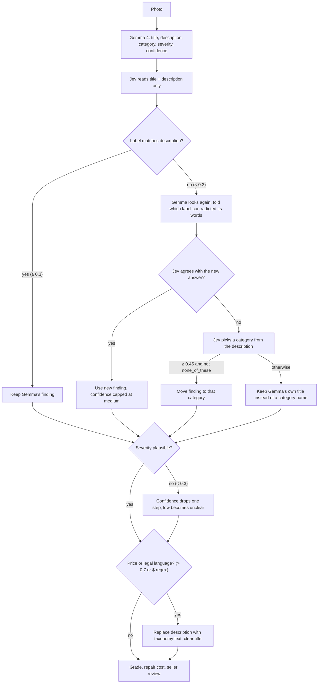

# Disclosure

**Photograph a home's problems. Review the AI's findings. Create a disclosure report.**
Disclosure helps home sellers turn photos of visible problems into a PDF report.

**[Try Disclosure](https://disclosure-app-jyruvsvlxa-uk.a.run.app/)** — hosted on Google Cloud.

**Gemma 4 analyzes the photos and provides information, but the final decision is up to the user.** The website connects to Gemma on a private Google Cloud server with a GPU. Gemma can also be ran locally using Ollama.

> **This tool helps document visible problems. It is not a home inspection or legal advice.** Use the report alongside an official disclosure form.

## The problem

Home sellers may notice damage but struggle to identify these problems. Photos with inaccurate descriptions can leave buyers unsure over the condition of the home, so sellers need a simple way to organize photos and descriptions into a report they can share.

## Workflow

1. **Capture:** take or upload a photo of a problem.
2. **Analyze:** Gemma 4 suggests a description and problem type, how serious the problem is, how soon it needs attention, and how confident the AI is.
3. **Review:** each finding shows its grade and a typical repair cost range. Confirm or correct each finding before continuing. TypeSafe can also check the AI's text before you review it.
4. **Export:** view or download the PDF report with findings, photos, grades & more.

## How we use Gemma 4

**Gemma 4 analyzes photos for Disclosure.** It receives a photo and instructions about housing problems, then returns a finding in a format the app can read.

### What the AI does and does not do

| Responsibility | How Disclosure handles it |
|---|---|
| Analyze photo| Gemma describes what it sees and suggests a category, severity, urgency, image quality, and confidence level |
| Second guess | If enabled, TypeSafe checks whether the category and severity match Gemma's words and flags cost or legal language |
| Calculate grades | The app applies a severity × urgency rule, described in the [technical guide](docs/technical-guide.md#the-grading-rule) |
| Look up repair cost ranges | A separate table supplies a low, high, and average price for each problem type and severity. The numbers come from public 2026 cost guides for the DC/MD/VA area, **not contractor quotes, so treat them as planning estimates** |
| Decide what enters the report | The seller confirms each finding and can edit or remove it |

The AI cannot certify that a home is safe or decide what the seller must disclose by law, and TypeSafe only checks text. The AI's confidence level helps guide review; it may be inaccurate.

TypeSafe is **off unless you turn it on**, and the shipped app runs without it. This is deliberate: the app must work with Gemma alone, with no outside service in the path, and no finding text should leave the server unless the operator chose that. Leaving `DISCLOSURE_TYPESAFE_URL` empty keeps every check off.

## Gemma to Jev workflow

Gemma sometimes writes a sentence that disagrees with its own label: "The wooden door trim shows rot near the base" filed under `siding_exterior`. The grade, repair cost, and form section all follow the label, so a wrong label is a wrong report line. When TypeSafe is enabled, its Jev model checks Gemma's words. Jev is a small judgment model: give it text and a question, get back a probability. It never sees the photo.



Each step is one function:

| Step | Function | What it does |
|---|---|---|
| Gemma reads the photo | `OllamaAnalyzer.analyze()` in [`app/inference/ollama_analyzer.py`](app/inference/ollama_analyzer.py) | Sends the sanitized photo and prompt to Ollama, parses the JSON finding |
| Jev checks the finding | `Judge.verify()` in [`app/inference/judge.py`](app/inference/judge.py) | Returns three probabilities: label matches, severity plausible, cost or legal language |
| Second look | `verify._second_look()` in [`app/verify.py`](app/verify.py) | Reanalyzes the same photo with a hint naming the contradiction; kept only if Jev agrees |
| Category pick | `Judge.classify()` and `verify._recategorize()` | Jev scores every taxonomy category from the text; moves the finding only when sure |
| Apply the rules | `verify.verify_finding()` | Runs the loop above and never raises; a TypeSafe outage keeps Gemma's finding and marks the check skipped |

Confidence is never raised by a fix. Jev never writes report text. Prices only ever come from our cost table.

TypeSafe is **off unless you turn it on**. Set `DISCLOSURE_TYPESAFE_URL`, `TYPESAFE_API_KEY`, and `DISCLOSURE_JUDGE_VERIFY=1` in `.env` to enable the loop. Thresholds and the full rule list are in the [technical guide](docs/technical-guide.md#typesafe-verification).

## Privacy

- **Photo details removed:** before analysis, photos are resized and saved without GPS location, timestamps, or camera information.
- **Cloud analysis:** Gemma has no access to image metadata, and has no way to store photos.
- **TypeSafe receives text only:** Jev receives Gemma's description and title. It does not receive images or email.
- **Session storage:** all information is kept in `localStorage`. “Delete this session” clears it from that browser; downloaded or emailed copies remain separate.
- **Optional email:** email delivery through SMTP.
- **Limited data collection:** the app has no accounts or analytics.

The [network test](tests/test_no_network.py) checks selected source files for external URLs written directly in the code.

## Local development

To use Disclosure, open the [hosted website](https://disclosure-app-jyruvsvlxa-uk.a.run.app/). The commands below are for developers running a separate copy on their own computer. `localhost` addresses in this section refer to that local copy.

### Windows

Requires Python 3.11+, Git, and [Ollama](https://ollama.com/download). Start Ollama before analyzing photos.

```powershell
git clone https://github.com/ben-robles/disclosure
cd disclosure
py -3.11 -m venv .venv
.\.venv\Scripts\python -m pip install -r requirements.txt
ollama pull gemma4:e4b
$env:DISCLOSURE_MODEL = "gemma4:e4b"
.\run.ps1
```

The backend API is available at **http://localhost:8000**. Add `-Lan` to the final command to use the app from a phone on the same trusted Wi-Fi network.

### macOS / Linux

From the cloned repository, using Python 3.11+:

```sh
python3 -m venv .venv
.venv/bin/python -m pip install -r requirements.txt
ollama pull gemma4:e4b
DISCLOSURE_MODEL=gemma4:e4b .venv/bin/python -m uvicorn app.main:create_app --factory --host 127.0.0.1 --port 8000
```

### Try the workflow without a model

```sh
.venv/bin/python -m tests.dev_server
```

On Windows, use `.\.venv\Scripts\python -m tests.dev_server`. This runs the real API on **http://localhost:8001** with preset AI responses, for API and PDF checks. To try the React interface without a model, use `VITE_MOCK_ANALYZER=1` (below).

### React interface

The Python backend serves the API only. The web app is the React interface in `frontend/`: start the Python backend, then run `npm install` and `npm run dev` from `frontend/`.

Vite forwards `/api` requests to port 8000. The React interface stores sessions in browser `localStorage`, queues photos for analysis, and creates PDFs. Use `VITE_MOCK_ANALYZER=1` for preset AI responses. The backend's TypeSafe checks apply to every analysis.

See the [technical guide](docs/technical-guide.md) for AI checks, testing, configuration, and deployment.

## License

Code is licensed under [MIT](LICENSE). Gemma model files are downloaded separately; check the selected model's license and usage requirements. Each test photo keeps its own license and credit requirements, listed in [the photo list](assets/test_photos/test_photos.csv) and [photo credits](assets/test_photos/ATTRIBUTION.md).
