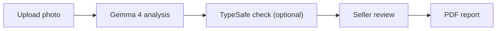

# Disclosure

**Photograph a home's problems. Review AI-assisted findings. Produce a disclosure report.**

Built for **GDG Build with AI x Hacktoberfest 2026: AI for Housing**, Disclosure helps home sellers turn photos of visible defects into a structured, seller-reviewed PDF report.

**[Try Disclosure](https://disclosure-app-jyruvsvlxa-uk.a.run.app/)** — hosted on Google Cloud Run. No installation required.

**Gemma 4 interprets the photo. TypeSafe checks the findings. The seller controls the report.** The live website connects to Gemma on a private Google Cloud GPU. Local Ollama is also supported for development.

> **AI-assisted documentation aid. Not a home inspection and not legal advice.** The report is a companion to the official disclosure form, not a replacement.

## From photo to report

1. **Capture:** take or upload a photo of a visible problem from a phone or computer.
2. **Analyze:** Gemma 4 proposes a description, defect category, severity, urgency, and confidence level.
3. **Review:** confirm, correct, or remove each finding. Optional TypeSafe verification checks the model's text before review.
4. **Export:** download a PDF with confirmed findings, photos, grades, cost ranges, and professional recommendations.

## How we use Gemma 4

**Gemma 4 powers the visual reasoning in Disclosure.** It receives the photo and a housing-specific prompt, then returns a structured finding that the rest of the application can process.

1. **Prepare the image.** [Image processing](app/images.py) applies orientation, removes metadata, and re-encodes the photo as a JPEG with a maximum 1024-pixel long edge.
2. **Run multimodal inference.** [OllamaAnalyzer](app/inference/ollama_analyzer.py) sends the photo as base64 alongside the prompt to Ollama's `/api/chat`. Requests use temperature `0` and configurable model keep-alive. The same adapter connects to local Ollama or our private Cloud Run GPU service. Recorded evaluations use **`gemma4:e4b`**.
3. **Describe before categorizing.** Prompt **v3.2** asks Gemma to write a visible-evidence sentence of at most 20 words and a short title, then return a defect type, severity **1–5**, urgency, confidence, image quality, and whether the category fits its description. It focuses on visible damage and distinguishes a blurry subject from a sharp subject on a blurred background.
4. **Validate structured output.** The [prompt and JSON schema](app/inference/prompts.py) are built from [27 defect categories plus `unclear`](assets/defect_taxonomy.json). The parser checks category IDs, allowed values, and severity bounds, cleans the title, and limits description length. Invalid output receives one retry before an unclear result.
5. **Take a second look when needed.** With TypeSafe verification enabled, a category that contradicts Gemma's description can trigger another Gemma analysis of the same photo, with the contradiction identified in the prompt. A revised finding must pass the configured text-consistency check, and its confidence is capped at medium.

Every Gemma call stays behind the [`DefectAnalyzer`](app/inference/analyzer.py) interface. This keeps image inference separate from grading, cost lookup, and report generation.

### What the AI does and does not do

| Responsibility | How Disclosure handles it |
|---|---|
| Interpret the photo | Gemma proposes visible evidence, a category, severity, urgency, image quality, and its own confidence |
| Check the description | Optional TypeSafe verification checks whether the category and severity agree with Gemma's words and flags cost or legal language |
| Calculate grades | Application code applies the published severity × urgency rule |
| Look up repair ranges | A separate table supplies illustrative ranges; **current repair prices are demonstration data, not verified estimates** |
| Decide what enters the report | The seller confirms each finding and can edit or remove it |

The models do not certify a home's safety or determine legal obligations. TypeSafe reads text rather than images, and model confidence is an indication for review rather than a professional assessment.

## TypeSafe verification

TypeSafe's Jev model provides an optional **text-only second opinion** through the [`Judge`](app/inference/judge.py) interface. It returns probabilities and category choices; application code maps those responses to existing finding states and messages.

- **Category consistency:** compare Gemma's category with its title and description. A flagged contradiction triggers the second-look flow, followed by a text-based category correction or a descriptive title fallback.
- **Severity consistency:** reduce confidence when the severity is inconsistent with the description. Low confidence produces an unclear finding without a grade.
- **Conservative corrections:** a second-look result is capped at medium confidence; text-based recategorization never raises confidence.
- **Cost and legal-language checks:** replace flagged prose with taxonomy text. A dollar-sign/number regex also runs in this verification path, including when the judge is unavailable.
- **Graceful fallback:** verification failures retain Gemma's finding and record the judge status. `NullJudge` makes no network calls when verification is unconfigured.
- **Photo test checks:** the [photo test script](scripts/run_test_set.py) can ask TypeSafe whether Gemma's description mentions the expected visible details and fits the expected defect type.

Live verification is wired into both the stored-session worker and `/api/analyze`, which the React UI uses. Jev never generates report prose; the seller remains the final reviewer.

To enable verification, add these settings to the gitignored `.env` and restart the backend:

```dotenv
DISCLOSURE_TYPESAFE_URL=<your TypeSafe API base URL>
TYPESAFE_API_KEY=<your API key>
DISCLOSURE_TYPESAFE_MODEL=jev-latest
DISCLOSURE_JUDGE_VERIFY=1
DISCLOSURE_JUDGE_CLASSIFY=0
```

Both URL and key are required. [`.env.example`](.env.example) documents configuration, [verification tests](tests/test_verify.py) cover the decision rules, and [experiment notes](docs/decisions.md#typesafe-text-judge-jev) record the model comparisons and threshold choices.

## Architecture



The **website runs on Google Cloud Run**. A FastAPI backend connects it to Gemma 4 through Ollama on a private GPU service. TypeSafe optionally checks Gemma's text. Application code handles grading and cost lookup, and the seller confirms every finding included in the report.

## The grading rule

**Risk = severity × urgency.** Urgency weights are immediate **4**, within 30 days **3**, within a year **2**, and cosmetic **1**.

| Risk | Letter | Label |
|---|---|---|
| 1–3 | A | Minor |
| 4–6 | B | Moderate |
| 7–10 | C | Serious |
| 11–15 | D | Urgent |
| 16–20 | F | Critical |

Confidence determines how the result appears: **high** shows one letter, **medium** shows the letter and the next worse one, and **low** shows no grade with a recommendation for a licensed home inspector.

> The overall grade is the worst grade among confirmed, graded findings. It is never an average.

## Guardrails

- **Blurry or non-house photo:** ask for a new photo and show no grade when flagged by the model.
- **Low confidence or unclear finding:** show no grade and recommend a licensed home inspector.
- **D or F grade:** recommend evaluation by the relevant licensed professional.
- **Invalid output:** retry once, then return unclear; do not display the unparsed response.
- **Timeout:** provide a Retry action. The default timeout is 120 seconds per inference request.
- **Model availability:** show a startup banner with the command to start Ollama or download the selected model.
- **Seller confirmation:** include confirmed findings only, and require confirmation again after an edit in the default app.
- **Disclosure:** show the disclaimer at the start, during review, and on every PDF page.

## Privacy

- **Metadata removal:** photos are resized and rebuilt without GPS, timestamps, or device metadata before analysis.
- **Hosted analysis:** the website and model service run on Google Cloud. Sanitized photos are sent to the private Gemma service for analysis; that inference service has no application photo-storage layer.
- **Text-only TypeSafe requests:** Jev receives Gemma's description, title, typed fields, and relevant taxonomy or fixture details. Images, session ZIP fields, and recipient email fields are not sent to TypeSafe. Descriptions can contain details visible in a photo; no zero-retention claim is made for the provider.
- **Browser session control:** the web interface keeps session photos, findings, and details in the browser's `localStorage`. “Delete this session” clears that session from the browser; downloaded or emailed copies are separate. The standalone Python interface stores its sessions under `data/` on the machine running that backend.
- **Optional email:** SMTP is disabled until configured. When requested, the provider receives the report and recipient; the endpoint does not save the uploaded attachment. Recipient addresses are kept in process memory for rate limiting.
- **Minimal collection:** no accounts or analytics in the default app. Faces and addresses visible inside a photo are not automatically redacted.

The [network test](tests/test_no_network.py) checks selected source files for hardcoded external URLs; endpoints are configured through environment variables.

## Accessibility

The default UI includes labeled controls, a skip link, visible keyboard focus, heading focus on screen changes, live announcements, and progress-bar semantics. Grade letters and text accompany colors. Controls have a minimum height of 44 pixels.

## Recorded performance

| Measurement | Recorded result | Scope |
|---|---|---|
| Per-photo analysis | **7.4 s median**, 5.4–10.2 s range | `gemma4:e4b`, prompt v3.2, 17-photo test run; excludes subsequent TypeSafe scoring and live verification |
| Warm GPU throughput | **17 photos in 62 s**, **16.3 photos/minute** | Separate Cloud Run L4 test with four workers; 17 successful analysis responses; model-only throughput |

See [full test results](docs/test-results.md) and [Cloud Run measurements](docs/gate0.md#cloud-run-gpu-us-east4-gemma4e4b) for the underlying evidence.

## How we test changes with photos

We keep **17 example photos with expected answers** and run the same photos through the AI after a change. This helps us catch a change that improves one answer but breaks another. Software developers call this a **regression test suite**: a repeatable check that previously working behavior still works.

For example:

- A roof-damage photo should still be categorized as roof damage.
- A cat photo should still be recognized as something other than a house.
- A blurry photo should still prompt a retake rather than receive a grade.

The [photo list](assets/test_photos/test_photos.csv) covers visible defects, blurry inputs, non-house images, and an undamaged room. The [test script](scripts/run_test_set.py) records the expected answer, the actual answer, and how long each photo takes. When configured, TypeSafe also checks whether Gemma's written description matches the expected visible details.

Results are saved in a [comparison report](docs/test-results.md), so we can compare prompt versions using the same examples. These photo checks evaluate the analyzer's answers; live verification and second-look behavior have separate [automated tests](tests/test_verify.py) and [experiment notes](docs/decisions.md#typesafe-text-judge-jev). All example photos are openly licensed, with [attribution recorded](assets/test_photos/ATTRIBUTION.md).

## Local development

To use Disclosure, open the [hosted website](https://disclosure-app-jyruvsvlxa-uk.a.run.app/). The commands below are for developers running a separate copy on their own computer. `localhost` addresses in this section refer to that local copy.

### Windows

Requires Python 3.11+, Git, and [Ollama](https://ollama.com/download). Start Ollama before analyzing photos.

```powershell
git clone https://github.com/ben-robles/disclosure
cd disclosure
py -3.11 -m venv .venv
.\.venv\Scripts\python -m pip install -r requirements.txt
ollama pull gemma4:e4b
$env:DISCLOSURE_MODEL = "gemma4:e4b"
.\run.ps1
```

Open **http://localhost:8000** for your local copy. Add `-Lan` to the final command for a phone on the same trusted Wi-Fi network.

### macOS / Linux

From the cloned repository, using Python 3.11+:

```sh
python3 -m venv .venv
.venv/bin/python -m pip install -r requirements.txt
ollama pull gemma4:e4b
DISCLOSURE_MODEL=gemma4:e4b .venv/bin/python -m uvicorn app.main:create_app --factory --host 127.0.0.1 --port 8000
```

### Try the workflow without a model

```sh
.venv/bin/python -m tests.dev_server
```

On Windows, use `.\.venv\Scripts\python -m tests.dev_server`. Open **http://localhost:8001**. This mode runs the real application with canned analyzer responses for UI and report walkthroughs.

### React interface

The default HTML/CSS/JavaScript app in `static/` is served by Python without a Node toolchain. To run the separate React interface, start the Python backend, then run `npm install` and `npm run dev` from `frontend/`.

Vite proxies `/api` to port 8000. React stores sessions in browser `localStorage` and manages its own queue and PDF generation. Use `VITE_MOCK_ANALYZER=1` for canned responses. TypeSafe verification applies to both interfaces through the backend.

### Configuration

Set environment variables before starting the backend or place them in the gitignored `.env`. Existing process environment variables take precedence.

| Setting | Purpose |
|---|---|
| `DISCLOSURE_MODEL` | Explicit downloaded model tag, such as `gemma4:e4b` |
| `DISCLOSURE_OLLAMA_URL` | Local Ollama, or `http://localhost:9090` for a developer's authenticated Cloud Run proxy |
| `DISCLOSURE_OLLAMA_TOKEN` | Optional direct IAM token; leave empty when using the proxy |
| `DISCLOSURE_WORKERS` | Backend worker count; match Ollama's `OLLAMA_NUM_PARALLEL` |
| `DISCLOSURE_KEEP_ALIVE` | Keep the model loaded between requests; default `30m` |
| `DISCLOSURE_TIMEOUT_S` | Timeout per inference request; default `120` seconds |
| `DISCLOSURE_DATA_DIR` | Backend storage directory; default `data/` |

For TypeSafe, use the [verification settings above](#typesafe-verification). For optional SMTP delivery, fill in [`.env.example`](.env.example) and save it as `.env`.

## Deployment

**Hosted website:** Disclosure is available at [disclosure-app-jyruvsvlxa-uk.a.run.app](https://disclosure-app-jyruvsvlxa-uk.a.run.app/) on Google Cloud Run. Users open the website directly from their browser.

**AI service:** Gemma 4 runs behind Ollama on a separate private Cloud Run service with an NVIDIA L4 GPU. The deployment configuration includes baked-in model weights, configurable concurrency, and instance limits.

**Local development:** developers can also run a copy of the app with local Ollama or connect to the hosted model through an authenticated proxy.

The [model-service deployment guide](cloud/README.md) covers prerequisites, deploying the GPU service, keeping an instance warm for a demo, scaling settings, and teardown.

## Development and testing

```sh
.venv/bin/python -m pytest tests
.venv/bin/python scripts/run_test_set.py
.venv/bin/python scripts/run_test_set.py --no-judge
```

On Windows, use `.\.venv\Scripts\python`. Automated tests cover parsing, grading, mapping, queue behavior, API operations, and TypeSafe verification with fake model responses. The photo runner uses the configured Gemma endpoint and optional TypeSafe scoring.

Photo results are stored by prompt version in `docs/test-results.md`, with raw per-photo JSON under `data/eval/<run>/`. See [the model/hardware measurement guide](docs/gate0.md) for streamed timing and one-versus-four-worker benchmarks.

Model calls belong behind `DefectAnalyzer`; text checks belong behind `Judge`. Grading rules, cost data, and jurisdiction mappings stay separate from prompts so each can be maintained and tested independently.

## License

Code is licensed under [MIT](LICENSE). Gemma weights are downloaded separately; consult the selected model's published license and usage requirements. Test photos retain their individual licenses and attribution requirements in [the manifest](assets/test_photos/test_photos.csv) and [Gate 0 attribution](assets/test_photos/ATTRIBUTION.md).
