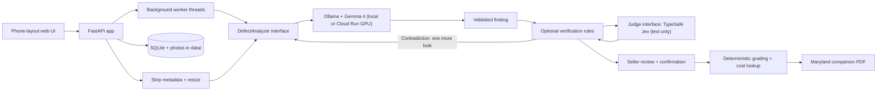

# Disclosure

**Photograph a home's problems. Review AI-assisted findings. Produce a disclosure report.**

Built for **GDG Build with AI x Hacktoberfest 2026: AI for Housing**, Disclosure helps home sellers turn photos of visible defects into a structured, seller-reviewed PDF companion report organized by Maryland's disclosure questions.

**Gemma 4 interprets the photo. TypeSafe checks the findings. The seller controls the report.** Run Gemma on a private Google Cloud GPU or locally through Ollama, with photo metadata removed before analysis.

> **AI-assisted documentation aid. Not a home inspection and not legal advice.** The report is a companion to the official disclosure form, not a replacement.

## From photo to report

1. **Capture:** take or upload a photo of a visible problem from a phone or computer.
2. **Analyze:** Gemma 4 proposes a description, defect category, severity, urgency, and confidence level.
3. **Review:** confirm, correct, or remove each finding. Optional TypeSafe verification checks the model's text before review.
4. **Export:** download a PDF with confirmed findings, photos, grades, cost ranges, and professional recommendations, grouped by Maryland disclosure questions.

## How we use Gemma 4

**Gemma 4 powers the visual reasoning in Disclosure.** It receives the photo and a housing-specific prompt, then returns a structured finding that the rest of the application can process.

1. **Prepare the image.** [Image processing](app/images.py) applies orientation, removes metadata, and re-encodes the photo as a JPEG with a maximum 1024-pixel long edge.
2. **Run multimodal inference.** [OllamaAnalyzer](app/inference/ollama_analyzer.py) sends the photo as base64 alongside the prompt to Ollama's `/api/chat`. Requests use temperature `0` and configurable model keep-alive. The same adapter connects to local Ollama or our private Cloud Run GPU service. Recorded evaluations use **`gemma4:e4b`**.
3. **Describe before categorizing.** Prompt **v3.2** asks Gemma to write a visible-evidence sentence of at most 20 words and a short title, then return a defect type, severity **1–5**, urgency, confidence, image quality, and whether the category fits its description. It focuses on visible damage and distinguishes a blurry subject from a sharp subject on a blurred background.
4. **Validate structured output.** The [prompt and JSON schema](app/inference/prompts.py) are built from [27 defect categories plus `unclear`](assets/defect_taxonomy.json). The parser checks category IDs, allowed values, and severity bounds, cleans the title, and limits description length. Invalid output receives one retry before an unclear result.
5. **Take a second look when needed.** With TypeSafe verification enabled, a category that contradicts Gemma's description can trigger another Gemma analysis of the same photo, with the contradiction identified in the prompt. A revised finding must pass the configured text-consistency check, and its confidence is capped at medium.

Every Gemma call stays behind the [`DefectAnalyzer`](app/inference/analyzer.py) interface. This keeps image inference separate from grading, cost lookup, and report generation.

### What the AI does and does not do

| Responsibility | How Disclosure handles it |
|---|---|
| Interpret the photo | Gemma proposes visible evidence, a category, severity, urgency, image quality, and its own confidence |
| Check the description | Optional TypeSafe verification checks whether the category and severity agree with Gemma's words and flags cost or legal language |
| Calculate grades | Application code applies the published severity × urgency rule |
| Look up repair ranges | A separate table supplies illustrative ranges; **current repair prices are demonstration data, not verified estimates** |
| Decide what enters the report | The seller confirms each finding and can edit or remove it |

The models do not certify a home's safety or determine legal obligations. TypeSafe reads text rather than images, and model confidence is an indication for review rather than a professional assessment.

## TypeSafe verification

TypeSafe's Jev model provides an optional **text-only second opinion** through the [`Judge`](app/inference/judge.py) interface. It returns probabilities and category choices; application code maps those responses to existing finding states and messages.

- **Category consistency:** compare Gemma's category with its title and description. A flagged contradiction triggers the second-look flow, followed by a text-based category correction or a descriptive title fallback.
- **Severity consistency:** reduce confidence when the severity is inconsistent with the description. Low confidence produces an unclear finding without a grade.
- **Conservative corrections:** a second-look result is capped at medium confidence; text-based recategorization never raises confidence.
- **Cost and legal-language checks:** replace flagged prose with taxonomy text. A dollar-sign/number regex also runs in this verification path, including when the judge is unavailable.
- **Graceful fallback:** verification failures retain Gemma's finding and record the judge status. `NullJudge` makes no network calls when verification is unconfigured.
- **Regression scoring:** the [evaluation runner](scripts/run_test_set.py) can ask TypeSafe whether Gemma's words mention expected fixture details and fit the expected defect type.

Live verification is wired into both the stored-session worker and `/api/analyze`, which the React UI uses. Jev never generates report prose; the seller remains the final reviewer.

To enable verification, add these settings to the gitignored `.env` and restart the backend:

```dotenv
DISCLOSURE_TYPESAFE_URL=<your TypeSafe API base URL>
TYPESAFE_API_KEY=<your API key>
DISCLOSURE_TYPESAFE_MODEL=jev-latest
DISCLOSURE_JUDGE_VERIFY=1
DISCLOSURE_JUDGE_CLASSIFY=0
```

Both URL and key are required. [`.env.example`](.env.example) documents configuration, [verification tests](tests/test_verify.py) cover the decision rules, and [experiment notes](docs/decisions.md#typesafe-text-judge-jev) record the model comparisons and threshold choices.

## Architecture



**Separate interfaces for separate jobs:** `DefectAnalyzer` handles image inference, `Judge` handles text evaluation, and deterministic modules handle grading, costs, and Maryland report mapping. SQLite persists sessions and findings while background workers process the queue. The default app generates PDFs with ReportLab; the React interface manages its own queue and report generation in the browser.

## The grading rule

**Risk = severity × urgency.** Urgency weights are immediate **4**, within 30 days **3**, within a year **2**, and cosmetic **1**.

| Risk | Letter | Label |
|---|---|---|
| 1–3 | A | Minor |
| 4–6 | B | Moderate |
| 7–10 | C | Serious |
| 11–15 | D | Urgent |
| 16–20 | F | Critical |

Confidence determines how the result appears: **high** shows one letter, **medium** shows the letter and the next worse one, and **low** shows no grade with a recommendation for a licensed home inspector.

> The overall grade is the worst grade among confirmed, graded findings. It is never an average.

## Guardrails

- **Blurry or non-house photo:** ask for a new photo and show no grade when flagged by the model.
- **Low confidence or unclear finding:** show no grade and recommend a licensed home inspector.
- **D or F grade:** recommend evaluation by the relevant licensed professional.
- **Invalid output:** retry once, then return unclear; do not display the unparsed response.
- **Timeout:** provide a Retry action. The default timeout is 120 seconds per inference request.
- **Model availability:** show a startup banner with the command to start Ollama or download the selected model.
- **Seller confirmation:** include confirmed findings only, and require confirmation again after an edit in the default app.
- **Disclosure:** show the disclaimer at the start, during review, and on every PDF page.

## Privacy

- **Metadata removal:** GPS, timestamps, and device metadata are stripped before analysis or storage. Only the sanitized JPEG is retained by the default backend.
- **Choice of inference location:** use local Ollama or the private Cloud Run service through an authenticated, encrypted proxy connection. Hosted mode sends sanitized photos to that service; it has no application photo-storage layer.
- **Text-only TypeSafe requests:** Jev receives Gemma's description, title, typed fields, and relevant taxonomy or fixture details. Images, session ZIP fields, and recipient email fields are not sent to TypeSafe. Descriptions can contain details visible in a photo; no zero-retention claim is made for the provider.
- **Local session control:** the default app stores photos, findings, edits, confirmations, reports, and an optional five-digit ZIP under `data/`. “Delete this session” removes its stored records, photos, and report; downloaded or emailed copies are separate.
- **Optional email:** SMTP is disabled until configured. When requested, the provider receives the report and recipient; the endpoint does not save the uploaded attachment. Recipient addresses are kept in process memory for rate limiting.
- **Minimal collection:** no accounts or analytics in the default app. Faces and addresses visible inside a photo are not automatically redacted.

The default server binds to `127.0.0.1`. Use `.\run.ps1 -Lan` for a phone on the same trusted Wi-Fi network, allowing Windows Firewall access on private networks only. For private remote access to the default app, use Tailscale Serve: `tailscale serve --bg --https=8443 http://127.0.0.1:8000`. Keep the unauthenticated app within a trusted network or tailnet.

The [network test](tests/test_no_network.py) checks selected source files for hardcoded external URLs; endpoints are configured through environment variables.

## Accessibility

The default UI includes labeled controls, a skip link, visible keyboard focus, heading focus on screen changes, live announcements, and progress-bar semantics. Grade letters and text accompany colors. Controls have a minimum height of 44 pixels.

## Recorded performance and evaluation

| Measurement | Recorded result | Scope |
|---|---|---|
| Per-photo analysis | **7.4 s median**, 5.4–10.2 s range | `gemma4:e4b`, prompt v3.2, 17-photo regression run; excludes subsequent TypeSafe scoring and live verification |
| Warm GPU throughput | **17 photos in 62 s**, **16.3 photos/minute** | Separate Cloud Run L4 test with four workers; 17 successful analysis responses; model-only throughput |

The [regression suite](assets/test_photos/test_photos.csv) contains **17 openly licensed photos** covering home defects, blurry inputs, non-house images, and an undamaged room. The runner records expected-category/quality matches, per-photo latency, and optional TypeSafe text scores, with raw JSON retained per run.

See [full evaluation results](docs/test-results.md), [Cloud Run measurements](docs/gate0.md#cloud-run-gpu-us-east4-gemma4e4b), and [photo attribution](assets/test_photos/ATTRIBUTION.md) for the underlying evidence. The batch runner evaluates analyzer output; live verification and second-look behavior have separate [tests](tests/test_verify.py) and [experiment notes](docs/decisions.md#typesafe-text-judge-jev).

## Setup

### Windows

Requires Python 3.11+, Git, and [Ollama](https://ollama.com/download). Start Ollama before analyzing photos.

```powershell
git clone https://github.com/ben-robles/disclosure
cd disclosure
py -3.11 -m venv .venv
.\.venv\Scripts\python -m pip install -r requirements.txt
ollama pull gemma4:e4b
$env:DISCLOSURE_MODEL = "gemma4:e4b"
.\run.ps1
```

Open **http://127.0.0.1:8000**. Add `-Lan` to the final command for a phone on the same trusted Wi-Fi network.

### macOS / Linux

From the cloned repository, using Python 3.11+:

```sh
python3 -m venv .venv
.venv/bin/python -m pip install -r requirements.txt
ollama pull gemma4:e4b
DISCLOSURE_MODEL=gemma4:e4b .venv/bin/python -m uvicorn app.main:create_app --factory --host 127.0.0.1 --port 8000
```

### Try the workflow without a model

```sh
.venv/bin/python -m tests.dev_server
```

On Windows, use `.\.venv\Scripts\python -m tests.dev_server`. Open **http://127.0.0.1:8001**. This mode runs the real application with canned analyzer responses for UI and report walkthroughs.

### React interface

The default HTML/CSS/JavaScript app in `static/` is served by Python without a Node toolchain. To run the separate React interface, start the Python backend, then run `npm install` and `npm run dev` from `frontend/`.

Vite proxies `/api` to port 8000. React stores sessions in browser `localStorage` and manages its own queue and PDF generation. Use `VITE_MOCK_ANALYZER=1` for canned responses. TypeSafe verification applies to both interfaces through the backend.

### Configuration

Set environment variables before starting the backend or place them in the gitignored `.env`. Existing process environment variables take precedence.

| Setting | Purpose |
|---|---|
| `DISCLOSURE_MODEL` | Explicit downloaded model tag, such as `gemma4:e4b` |
| `DISCLOSURE_OLLAMA_URL` | Local Ollama, or `http://127.0.0.1:9090` for the authenticated Cloud Run proxy |
| `DISCLOSURE_OLLAMA_TOKEN` | Optional direct IAM token; leave empty when using the proxy |
| `DISCLOSURE_WORKERS` | Backend worker count; match Ollama's `OLLAMA_NUM_PARALLEL` |
| `DISCLOSURE_KEEP_ALIVE` | Keep the model loaded between requests; default `30m` |
| `DISCLOSURE_TIMEOUT_S` | Timeout per inference request; default `120` seconds |
| `DISCLOSURE_DATA_DIR` | Backend storage directory; default `data/` |

For TypeSafe, use the [verification settings above](#typesafe-verification). For optional SMTP delivery, fill in [`.env.example`](.env.example) and save it as `.env`.

## Deployment

**Local:** run the app and Ollama on one computer, with optional phone access over trusted Wi-Fi.

**Google Cloud:** run Gemma 4 behind Ollama on a private Cloud Run service with an NVIDIA L4 GPU. The laptop backend connects through an authenticated proxy while retaining session storage and reporting locally. Deployment configuration includes baked-in model weights, configurable concurrency, and instance limits.

[Cloud deployment instructions](cloud/README.md) cover prerequisites, deployment, keeping an instance warm for a demo, scaling settings, and teardown.

## Development and testing

```sh
.venv/bin/python -m pytest tests
.venv/bin/python scripts/run_test_set.py
.venv/bin/python scripts/run_test_set.py --no-judge
```

On Windows, use `.\.venv\Scripts\python`. Automated tests cover parsing, grading, mapping, queue behavior, API operations, and TypeSafe verification with fake model responses. The photo runner uses the configured Gemma endpoint and optional TypeSafe scoring.

Photo results are stored by prompt version in `docs/test-results.md`, with raw per-photo JSON under `data/eval/<run>/`. See [the model/hardware measurement guide](docs/gate0.md) for streamed timing and one-versus-four-worker benchmarks.

Model calls belong behind `DefectAnalyzer`; text checks belong behind `Judge`. Grading rules, cost data, and jurisdiction mappings stay separate from prompts so each can be maintained and tested independently.

## Maryland report mapping

The PDF groups confirmed findings around questions from the [Maryland Residential Property Disclosure and Disclaimer Statement](https://labor.md.gov/forms/propertydanddform.pdf), using the [mapping data in this repository](assets/jurisdiction_md.json).

Foundation, roof, plumbing, electrical, and wood-destroying insects map to their corresponding questions. Water intrusion, mold, and window or door damage are grouped under question 25, “Other material defects.” Unclear findings appear in an inspector-review group. These groupings organize documentation; they do not determine legal disclosure obligations.

## License

Code is licensed under [MIT](LICENSE). Gemma weights are downloaded separately; consult the selected model's published license and usage requirements. Test photos retain their individual licenses and attribution requirements in [the manifest](assets/test_photos/test_photos.csv) and [Gate 0 attribution](assets/test_photos/ATTRIBUTION.md).
