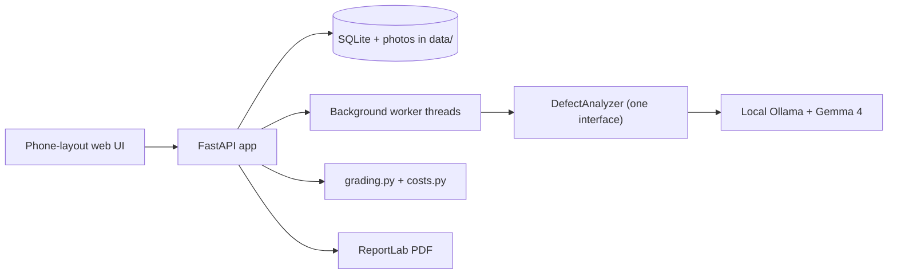

# Disclosure

Selling a home in Maryland means telling the buyer about problems you know of, and most sellers do not know how to document them. Disclosure is a seller-side tool: photograph a defect, get a first-pass classification from a local AI model, confirm or correct it, and produce a PDF disclosure report organized by the sections of Maryland's seller disclosure form.

It is built for home sellers in the DC/Maryland/Virginia area. The AI runs on your own computer. Nothing is uploaded unless you choose to email yourself the finished report.

> **AI-assisted documentation aid. Not a home inspection and not legal advice.**

## Status

The app, grading, cost lookup, queue, PDF report and all guardrails are built and tested. **Not yet run against real Gemma 4 on the Windows demo laptop.** The [Gate 0 runner](docs/gate0.md) includes licensed photos, streamed timing, production JSON checks, and controlled one-versus-four-worker benchmarks. Windows certification remains pending. Items still to fill are listed in [`docs/decisions.md`](docs/decisions.md) under "Human must fill".

Screenshots: PLACEHOLDER (add after the first run on the demo machine).

Next performance work: [smaller-model comparison and inference-speed handoff](docs/inference-speed-handoff.md).

## What the AI does and never does

- **Does:** looks at one photo and picks one of 28 fixed types, listed in `assets/defect_taxonomy.json` (roof, chimney, gutters, grading, siding, deck, water intrusion, basement moisture, mold, foundation, electrical, panel, plumbing, water heater, heating, cooling, insulation, windows and doors, walls, flooring, stairs, pests, alarms, hazardous materials, septic, fire damage, and more; unclear when it cannot tell). Rates severity (1-5), urgency and its own confidence. Writes one sentence about what is visible.
- **Never:** writes dollar amounts, gives legal conclusions, or gives a grade when it is unsure. Cost ranges come from a hand-built table the model never sees. Nothing goes in the report until you confirm it.

## The grading rule

Risk = severity × urgency (immediate 4, within 30 days 3, within a year 2, cosmetic 1).

| Risk | Letter |
|---|---|
| 1-3 | A (Minor) |
| 4-6 | B (Moderate) |
| 7-10 | C (Serious) |
| 11-15 | D (Urgent) |
| 16-20 | F (Critical) |

Confidence sets the width of the grade: high shows one letter ("C"), medium shows the letter and the next worse one ("C–D"), low shows no grade and says "Can't tell — get an inspector".

> The overall grade is the worst grade among your confirmed findings. It is never an average.

## Guardrails

1. Blurry photo: "Photo too blurry — retake closer and in better light." No grade.
2. Not a house: "This doesn't look like part of a home. Try again." No grade.
3. Low confidence: "Can't tell from this photo — recommend a licensed home inspector." No grade.
4. Any finding graded D or F adds "Recommend evaluation by a licensed [pro]" to the report.
5. Invalid model output gets one retry, then becomes "unclear". The app never shows raw model text.
6. Timeout after 120 s per photo shows "Analysis timed out" with a Retry button.
7. If Ollama is not running or the model is not downloaded, a banner shows the exact command to fix it.
8. The disclaimer appears on first load, on the review screen, and in the footer of every PDF page.

Screenshots of each: PLACEHOLDER.

## Privacy

- The server listens on `127.0.0.1` only. `.\run.ps1 -Lan` listens on all interfaces so a phone on the same Wi-Fi can open the app. Windows Firewall will ask: allow it on private networks only.
- To open the app from your own devices away from home, use Tailscale Serve (tailnet only, not public): `tailscale serve --bg --https=8443 http://127.0.0.1:5173`. Photos travel encrypted between your devices and this computer, and the server still listens on `127.0.0.1`. Do not use Tailscale Funnel or a public tunnel: that sends photos from strangers to your model.
- The only outbound calls are to the local Ollama server and, only if you ask for the report by email, to the SMTP server you configure (copy `.env.example` to `.env` and fill it in; `.env` is git-ignored). The address and PDF are not stored. Leave those unset and email is disabled. A test (`tests/test_no_network.py`) fails if any other URL appears in the code.
- Photo metadata (GPS, time, device) is stripped on upload. Photos are resized to 1024 px on the long edge, which also keeps analysis fast.
- Data kept: photos, your confirmations and edits, and an optional 5-digit ZIP printed on the report. All of it lives in `data/` on this computer. "Delete this session" erases it.
- No accounts, no analytics, no faces or addresses collected.

## Setup

### Quick start (Windows)

```powershell
# Python 3.11+ and Git are required. Install Ollama from ollama.com.
git clone https://github.com/ben-robles/disclosure
cd disclosure
py -3.11 -m venv .venv
.\.venv\Scripts\python -m pip install -r requirements.txt
ollama pull gemma4:e2b      # or the tag verified in Gate 0
.\run.ps1                   # http://127.0.0.1:8000  (add -Lan for a phone on the same Wi-Fi)
```

### macOS / Linux (development)

`run.ps1` is Windows-only. Run the same server directly:

```sh
python3 -m venv .venv
.venv/bin/python -m pip install -r requirements.txt
.venv/bin/python -m uvicorn app.main:create_app --factory --port 8000
```

Without Ollama the page loads and shows the "model not running" banner; use
`.venv/bin/python -m tests.dev_server` to try the full flow with canned answers.

The UI is plain HTML, CSS and JavaScript in `static/`, served by the app. The
`frontend/` folder is a separate React prototype from Lovable. The app does not use
it, and the build plan calls for no Node toolchain.

### Gate 0 (certify Gemma on the demo laptop)

Complete [Gate 0](docs/gate0.md) before the demo: quit the Ollama tray app, then run
`.\scripts\gate0_windows.ps1` from the Windows checkout. It starts a local server,
pulls `gemma4:e2b`, tests both licensed defect photos through the CLI, HTTP API and
production analyzer, restarts the server for one/four workers, and saves raw evidence
and draft reports in `data/gate0/<run>/`. Inspect image-specific replies before
recording a pass. If E2B fails vision or latency, run once with `-Model gemma4:e4b`.
After review, set `DISCLOSURE_MODEL` to the verified explicit tag and
`DISCLOSURE_WORKERS` to the measured choice. Restart Ollama with matching
`OLLAMA_NUM_PARALLEL`, then use `.\run.ps1` (localhost) or `.\run.ps1 -Lan`
(prints a phone URL). The small direct check still works:
`.\.venv\Scripts\python scripts\gate0_ollama.py <tag> photo.jpg`.

Tested Windows specs, model size and measured latency per photo: pending;
see [Gate 0](docs/gate0.md) and [environment status](docs/environment.md).

Settings (environment variables): `DISCLOSURE_MODEL`, `DISCLOSURE_WORKERS` (photos analyzed at once, default 1 pending Gate 0 measurements; match Ollama's `OLLAMA_NUM_PARALLEL`), `DISCLOSURE_KEEP_ALIVE`, `DISCLOSURE_TIMEOUT_S`, `DISCLOSURE_DATA_DIR`. Set the explicit verified model tag after reviewing Gate 0; the existing app model default is still unverified.

Tests: `.\.venv\Scripts\python -m pytest`. To try the UI without Gemma: `.\.venv\Scripts\python -m tests.dev_server` (canned fake answers, http://127.0.0.1:8001).

## Architecture



Everything that touches the model is behind `DefectAnalyzer` (`app/inference/`). Swapping the runtime means writing one other class.

## Deployment path for a nonprofit

One laptop, one install, no API keys, no monthly cost. Gemma 4 has official on-device runtimes (LiteRT-LM for Android and iOS), so a phone build is the next step. **It is future work: today the model runs on the laptop, not on a phone.**

## Jurisdiction

The report is a companion document organized by the numbered questions of the [Maryland Residential Property Disclosure and Disclaimer Statement](https://labor.md.gov/forms/propertydanddform.pdf) (printed revision "Rev August 3, 2026"). Foundation, roof, plumbing, electrical and wood-destroying insects map to their own questions. Water intrusion, mold and window or door damage have no matching question and are listed under question 25 (other material defects). It does not replace the official form. DC and Virginia are future work (Virginia's regime is buyer-beware, so its form has no itemized conditions to map).

## Test photos and results

15 openly licensed photos from Wikimedia Commons in [`assets/test_photos/`](assets/test_photos/): 10 defects covering all 8 defect types, 2 blurry, 2 not a house (a cat, a road), 1 undamaged room. Source, author and license per file: [`test_photos.csv`](assets/test_photos/test_photos.csv). Two further Gate 0 photos have [attribution and expected visible details](assets/test_photos/ATTRIBUTION.md).

Results: PLACEHOLDER. Run `scripts\run_test_set.py` on the Gemma machine; it writes `docs/test-results.md`. A two-photo Gate 0 run is not the full accuracy evaluation.

## The user

PLACEHOLDER: see [`docs/user-interview.md`](docs/user-interview.md) and [`docs/personas.md`](docs/personas.md).

## Known limitations

- One model, no fine-tuning, one photo per finding.
- Not yet measured on real Gemma 4: accuracy and latency are unknown.
- The cost table is placeholder data.
- One state (Maryland).
- Not an inspection. Runs on a laptop, not a phone.

## License

Code: Apache-2.0 (see `LICENSE`). The Gemma 4 weights are not in this repository and are covered by Google's Gemma Terms of Use. Check them before you redistribute or deploy.
