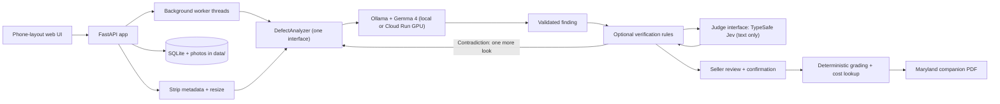

# Disclosure

**Photograph a home's problems. Review AI-assisted findings. Produce a disclosure report.**

Built for **GDG Build with AI x Hacktoberfest 2026: AI for Housing**, Disclosure is a seller-side tool: photograph a visible defect, get a first-pass finding from Gemma 4, confirm or correct it, and produce a PDF companion report organized by Maryland's seller disclosure questions.

It is built for home sellers in the DC/Maryland/Virginia area. The AI runs on a private GPU server we host on Google Cloud, or on your own computer if you run Ollama locally. Photos are stripped of location and device data before they leave.

> **AI-assisted documentation aid. Not a home inspection and not legal advice.** A photo cannot establish a home's overall safety or reveal hidden defects. The report does not replace the official disclosure form.

## Status

| Available today | Evidence |
|---|---|
| Photo upload, background queue, seller review, deterministic grading, and PDF export | [Application](app/main.py), [queue](app/queue.py), [grading](app/grading.py), and [reports](app/report/) |
| Gemma 4 image inference, locally or on a private Cloud Run L4 GPU | [Ollama adapter](app/inference/ollama_analyzer.py) and [Cloud Run measurements](docs/gate0.md#cloud-run-gpu-us-east4-gemma4e4b) |
| Optional TypeSafe text verification and a second Gemma look on contradictory answers | [Verification logic](app/verify.py) and [tests](tests/test_verify.py) |
| A 17-photo regression evaluation | Default prompt v3.2: **12/17 expected matches**, **5.4–10.2 s** per photo; [full results](docs/test-results.md#prompt-v32) |

Windows demo certification, broad accuracy/bias validation, accessibility verification, and verified repair prices remain pending. Recorded evaluation results are discussed [below](#test-photos-and-results); they do not certify home safety.

## Rubric alignment

The shared rubric has four categories worth 25 points each. These are available weights, not scores claimed by the project.

| Category | What to assess | Evidence and remaining gaps |
|---|---|---|
| **Problem Validation and Social Impact (25)** | Problem Definition **10**, Impact Multiplier **10**, Stakeholder Empathy **5** | A defined Maryland seller workflow and [form mapping](#jurisdiction). User feedback and measured impact are not yet available. |
| **Technical Innovation and AI Architecture (25)** | AI Integration and Necessity **15**, Architectural Soundness **10** | [Gemma interprets photos](#how-we-use-gemma-4); [TypeSafe checks its text](#typesafe-verification); modular [architecture](#architecture) and [real-model results](#test-photos-and-results). Evaluation of the complete verification loop remains pending. |
| **Responsible AI, Ethics and Accessibility (25)** | Safety and Grounding **10**, Privacy and Data Ethics **8**, Inclusive Design **7** | [Guardrails](#guardrails), [privacy controls](#privacy), seller confirmation, and [accessibility features](#accessibility). Bias, adversarial robustness, and full accessibility checks remain unverified. |
| **Feasibility, Scalability and Sustainability (25)** | Deployment Viability **10**, Inference Cost Efficiency **8**, Documentation and Maintenance **7** | [Setup](#setup), a [private GPU deployment](cloud/README.md), [measured warm throughput](#test-photos-and-results), isolated model interfaces, and an [MIT license](LICENSE). Cold-start reliability and full operating-cost measurements need work. |

For a quick UI/report walkthrough without a model, use `python -m tests.dev_server` from the installed virtual environment and open **http://127.0.0.1:8001**. Findings in that mode are canned, not Gemma results.

## How we use Gemma 4

**Gemma 4 is the visual reasoning model at the center of the product.** It interprets the uploaded photo; TypeSafe receives only its text, and application code calculates grades, looks up costs, and produces the PDF. We use existing model weights without fine-tuning.

1. **Prepare the photo.** [Image processing](app/images.py) strips metadata, applies orientation, and re-encodes the image as a JPEG with a maximum 1024-pixel long edge.
2. **Run multimodal inference.** [OllamaAnalyzer](app/inference/ollama_analyzer.py) sends the image as base64 alongside a housing-specific prompt to Ollama's `/api/chat`. Requests use temperature `0` and configurable model keep-alive. The same adapter supports local Ollama and our private Google Cloud Run GPU service. Recorded evaluations use **`gemma4:e4b`**.
3. **Describe before categorizing.** Default prompt **v3.2** asks Gemma to write a visible-evidence sentence of at most 20 words and a short title, then choose a defect type, severity **1–5**, urgency, confidence, image quality, and `category_fits`. The prompt distinguishes visible damage from possible future consequences and distinguishes a blurry subject from a sharp subject on a blurred background.
4. **Validate the result.** The prompt and JSON schema are built from [27 defect categories plus `unclear`](assets/defect_taxonomy.json). The parser checks allowed categories, enum values, and severity bounds, cleans the title, and limits the reason length. Invalid output gets one retry, then becomes an unclear finding. If the runtime rejects structured `format` with HTTP 501, the adapter retries without it and still validates the text.
5. **Review, then export.** With optional verification enabled, contradictory answers can trigger a second Gemma look at the same photo. The seller then confirms, edits, or removes each finding. Only confirmed findings enter the report.

The prompt and output schema live in [`app/inference/prompts.py`](app/inference/prompts.py); every model call stays behind the [`DefectAnalyzer`](app/inference/analyzer.py) interface.

### What the AI does and does not do

- **Gemma proposes:** a visible description, category, severity, urgency, image quality, and its own confidence. Categories cover roofs, chimneys, drainage, water intrusion, foundations, electrical systems, plumbing, HVAC, windows, pests, and other home components.
- **TypeSafe optionally checks:** whether Gemma's category and severity agree with its words, and whether those words contain cost or legal claims. It does not inspect the photo or generate report prose.
- **Application code calculates:** letter grades, cost-table lookups, professional recommendations, and Maryland report grouping. **Repair price ranges are placeholder data, not verified estimates.**
- **The seller controls:** confirmation and edits. Neither model independently certifies a home's condition, decides legal obligations, or adds unconfirmed findings to the report.

Costs and legal language are prohibited by the prompt. Parsing validates structure, not factual truth; optional verification adds checks described below. Model confidence and TypeSafe probabilities are not independently validated safety measures.

## TypeSafe verification

TypeSafe's Jev model is an optional, **text-only second opinion** behind a separate [`Judge`](app/inference/judge.py) interface. Its responses are probabilities and category choices. Application rules map them to findings; no TypeSafe-generated prose reaches the report.

| Use | What it does | Current decision |
|---|---|---|
| Evaluation scoring | Scores whether Gemma's description mentions expected fixture details and is consistent with the expected defect type. Exact-category/quality matching remains a separate code check. | Implemented in [the evaluation runner](scripts/run_test_set.py); optional when credentials are configured |
| Live verification | Checks label/description agreement, severity plausibility, and cost/legal language. | Retained after testing; enable explicitly with `DISCLOSURE_JUDGE_VERIFY=1` |
| Full text-based classification | Experimental v4: Gemma describes the photo while Jev selects the type and a probability-derived confidence band. | **Leave off:** recorded v4 matched **10/17**, compared with **12/17** for v3/v3.2. This is not evidence of calibrated confidence. |

With live verification enabled, [`verify_finding`](app/verify.py) applies these rules:

- **Label contradicts description:** if the judge's agreement probability is below `0.3`, ask Gemma to inspect the same photo again with the contradiction named. Accept the revised finding only if it is gradable and its agreement score is no longer below that threshold; revised confidence is capped at medium.
- **Second look does not resolve it:** try a text-based category correction supported by a top-choice probability of at least `0.45`, without raising confidence. Otherwise retain the original category internally and display Gemma's title or “Other issue.” The retained category still drives grading and cost lookup; title fallback does not prove the category is correct.
- **Severity contradicts description:** below `0.3` plausibility, lower confidence one step. Low confidence becomes `unclear`, with no grade.
- **Cost/legal language:** above `0.7`, replace the reason with taxonomy text and clear the title. A dollar-sign/number regex also runs in this verification path even if the judge is unavailable.
- **Judge unavailable:** retain Gemma's finding and mark `judge_status = unavailable`. When unconfigured, `NullJudge` makes no network calls. Experimental classification mode instead shows Retry if it cannot obtain a category.

Verification is wired into both the stored-session worker and `/api/analyze`, which the React UI uses. The probabilities and thresholds are heuristics, not validated correctness guarantees. **A text judge cannot detect a visual mistake when Gemma's sentence and category agree about the wrong thing.** The recorded mold-photo investigation demonstrates this limit: a second look still failed to identify the mold.

To enable the retained verification approach, set these in the gitignored `.env` and restart the backend:

```dotenv
DISCLOSURE_TYPESAFE_URL=<your TypeSafe API base URL>
TYPESAFE_API_KEY=<your API key>
DISCLOSURE_TYPESAFE_MODEL=jev-latest
DISCLOSURE_JUDGE_VERIFY=1
DISCLOSURE_JUDGE_CLASSIFY=0
```

Both URL and key are required; flags default to off. See [`.env.example`](.env.example) for configurable thresholds, [verification tests](tests/test_verify.py), and [the recorded experiment decisions](docs/decisions.md#typesafe-text-judge-jev).

## The grading rule

Risk = severity × urgency (immediate 4, within 30 days 3, within a year 2, cosmetic 1).

| Risk | Letter |
|---|---|
| 1-3 | A (Minor) |
| 4-6 | B (Moderate) |
| 7-10 | C (Serious) |
| 11-15 | D (Urgent) |
| 16-20 | F (Critical) |

Confidence sets the width of the grade: high shows one letter ("C"), medium shows the letter and the next worse one ("C–D"), low shows no grade and says "Can't tell — get an inspector".

> The overall grade is the worst grade among your confirmed findings. It is never an average.

## Guardrails

1. Blurry photo: "Photo too blurry — retake closer and in better light." No grade.
2. Not a house: "This doesn't look like part of a home. Try again." No grade.
3. Low confidence: "Can't tell from this photo — recommend a licensed home inspector." No grade.
4. Any finding graded D or F adds "Recommend evaluation by a licensed [pro]" to the report.
5. Invalid model output gets one retry, then becomes "unclear". The app never shows raw model text.
6. An inference request that times out shows "Analysis timed out" with a Retry button. The default timeout is 120 s per request; retries and a second look can make total processing longer.
7. If Ollama is not running or the model is not downloaded, a banner shows the exact command to fix it.
8. The disclaimer appears on first load, on the review screen, and in the footer of every PDF page.

The list describes implemented behavior, not a guarantee that Gemma recognizes every bad input. TypeSafe verification adds consistency checks when enabled, but does not replace human review.

## Privacy

- The server listens on `127.0.0.1` only. `.\run.ps1 -Lan` listens on all interfaces so a phone on the same Wi-Fi can open the app. Windows Firewall will ask: allow it on private networks only.
- To open the default app from your own devices away from home, use Tailscale Serve (tailnet only, not public): `tailscale serve --bg --https=8443 http://127.0.0.1:8000`. The separate React development server normally uses port `5173`. Do not expose the unauthenticated app through a public tunnel.
- **Gemma data path:** `DISCLOSURE_OLLAMA_URL` selects local Ollama or the private Cloud Run service through an authenticated proxy. In hosted mode, sanitized photos leave this computer over the proxy's encrypted Cloud Run connection. The inference service has no application photo-storage layer. This is distinct from local-only mode.
- **TypeSafe data path:** off unless both `DISCLOSURE_TYPESAFE_URL` and `TYPESAFE_API_KEY` are set. Requests contain Gemma's `reason`, `title`, typed fields, and taxonomy/expected-detail text as needed. Images, session ZIP fields, and recipient email fields are not sent to TypeSafe. Model descriptions may still contain sensitive details; a text-only request is not a guarantee of anonymity or zero provider retention.
- **Optional email:** a configured SMTP provider receives the recipient and report only when requested. The delivery endpoint does not save its uploaded attachment; recipient addresses remain in process memory for rate limiting. Leave SMTP settings unset to disable email. `.env` is gitignored.
- **Network check:** `tests/test_no_network.py` rejects hardcoded external URLs in selected source files. This is a source-code check, not a runtime network monitor; endpoint URLs are configurable.
- Photo metadata (GPS, time, device) is stripped on upload. Photos are resized to 1024 px on the long edge, which also keeps analysis fast.
- Data kept: photos, your confirmations and edits, and an optional 5-digit ZIP printed on the report. All of it lives in `data/` on this computer. "Delete this session" erases it.
- No accounts or analytics in the default app. Faces or addresses visible inside photos are not automatically redacted. The React prototype uses browser storage and has different report fields; the SQLite/storage description above applies to the default Python app.

## Accessibility

The default UI includes labeled controls, a skip link, visible focus styles, heading focus on screen changes, live announcements, progress-bar semantics, and grade letters/text alongside colors. Controls have a minimum height of 44 pixels. Screen-reader, complete keyboard, contrast, and zoom verification remain pending; these features are not a claim of WCAG conformance.

## Setup

### Quick start (Windows)

```powershell
# Python 3.11+ and Git are required. Install Ollama from ollama.com.
git clone https://github.com/ben-robles/disclosure
cd disclosure
py -3.11 -m venv .venv
.\.venv\Scripts\python -m pip install -r requirements.txt
ollama pull gemma4:e2b      # or the tag verified in Gate 0
$env:DISCLOSURE_MODEL = "gemma4:e2b"  # use the explicit tag you downloaded
.\run.ps1                   # http://127.0.0.1:8000  (add -Lan for a phone on the same Wi-Fi)
```

### macOS / Linux (development)

`run.ps1` is Windows-only. Run the same server directly:

```sh
python3 -m venv .venv
.venv/bin/python -m pip install -r requirements.txt
ollama pull gemma4:e2b
DISCLOSURE_MODEL=gemma4:e2b .venv/bin/python -m uvicorn app.main:create_app --factory --port 8000
```

Without Ollama the page loads and shows the "model not running" banner; use
`.venv/bin/python -m tests.dev_server` to try the full flow with canned answers.

The default UI is plain HTML, CSS and JavaScript in `static/`, served by the app without a Node toolchain. The separate React prototype in `frontend/` runs with `npm install` then `npm run dev` from that directory, alongside the Python backend. It stores sessions in browser `localStorage` and sends photos to `/api/analyze`; Vite proxies `/api` to port 8000. Its queue and PDF generation live in the browser, so backend worker settings do not control that queue. Use `VITE_MOCK_ANALYZER=1` for its canned-response mode. Verification applies to both interfaces; leave experimental classification off for the demo.

### Gate 0 (certify Gemma on the demo laptop)

Complete [Gate 0](docs/gate0.md) before the demo: quit the Ollama tray app, then run
`.\scripts\gate0_windows.ps1` from the Windows checkout. It starts a local server,
pulls `gemma4:e2b`, tests both licensed defect photos through the CLI, HTTP API and
production analyzer, restarts the server for one/four workers, and saves raw evidence
and draft reports in `data/gate0/<run>/`. Inspect image-specific replies before
recording a pass. If E2B fails vision or latency, run once with `-Model gemma4:e4b`.
After review, set `DISCLOSURE_MODEL` to the verified explicit tag and
`DISCLOSURE_WORKERS` to the measured choice. Restart Ollama with matching
`OLLAMA_NUM_PARALLEL`, then use `.\run.ps1` (localhost) or `.\run.ps1 -Lan`
(prints a phone URL). The small direct check still works:
`.\.venv\Scripts\python scripts\gate0_ollama.py <tag> photo.jpg`.

Tested Windows specs, model size and measured latency per photo: pending;
see [Gate 0](docs/gate0.md) and [environment status](docs/environment.md).

Settings (environment variables): `DISCLOSURE_OLLAMA_URL` (default `http://127.0.0.1:11434`; set to `http://127.0.0.1:9090` with the Cloud Run proxy, see `cloud/README.md`), `DISCLOSURE_OLLAMA_TOKEN` (only for a direct IAM token), `DISCLOSURE_MODEL`, `DISCLOSURE_WORKERS` (photos analyzed at once, default 1 pending Gate 0 measurements; match Ollama's `OLLAMA_NUM_PARALLEL`), `DISCLOSURE_KEEP_ALIVE`, `DISCLOSURE_TIMEOUT_S`, `DISCLOSURE_DATA_DIR`. Set the explicit verified model tag after reviewing Gate 0; the existing app model default is still unverified.

Tests: `.\.venv\Scripts\python -m pytest`. To try the UI without Gemma: `.\.venv\Scripts\python -m tests.dev_server` (canned fake answers, http://127.0.0.1:8001).

## Architecture



`DefectAnalyzer` isolates image inference; `Judge` isolates text evaluation. Verification and optional recategorization live in `app/verify.py`, while the experimental classification path lives in `app/classify.py`. Grading, cost lookup, and report mapping remain separate deterministic modules. SQLite stores findings and judge fields for the default app; the React UI calls the same verified single-photo endpoint but manages its own queue and reports.

## Deployment path for a nonprofit

Local mode runs on one computer without a paid model API; hardware and electricity still have costs. Hosted mode runs Gemma on a private Cloud Run L4 GPU, reached through an authenticated proxy; TypeSafe verification additionally requires API credentials. [Deployment instructions](cloud/README.md) cover installation, warm instances for demos, scaling limits, and teardown. The backend and data remain on the laptop: this is not yet a hosted multi-user product. Running the model directly on a phone is future work.

## Jurisdiction

The report is a companion document organized by the numbered questions of the [Maryland Residential Property Disclosure and Disclaimer Statement](https://labor.md.gov/forms/propertydanddform.pdf), using the [mapping recorded in this repository](assets/jurisdiction_md.json). Foundation, roof, plumbing, electrical and wood-destroying insects map to their own questions. Water intrusion, mold and window or door damage are grouped under question 25 (other material defects). These groupings do not determine a seller's legal obligations. The mapping records a printed revision of "Rev August 3, 2026" and notes that its currency still needs confirmation. It does not replace the official form. DC and Virginia are future work.

## Test photos and results

The [manifest](assets/test_photos/test_photos.csv) includes **17 openly licensed Wikimedia Commons photos**: 12 defect photos covering nine of the 27 defect categories, two blurry photos, two non-house photos, and one undamaged room. It includes the two [attributed Gate 0 fixtures](assets/test_photos/ATTRIBUTION.md). These are regression fixtures, not a representative validation dataset or professional severity ground truth.

### Recorded Gemma and TypeSafe experiments

All rows below use `gemma4:e4b`; per-photo outputs are preserved in [the result report](docs/test-results.md).

| Prompt | Division of work | Expected category / quality matches |
|---|---|---|
| v3 | Gemma describes and categorizes; optional TypeSafe evaluation scores its text | 12/17 |
| v3.1 | Longer prompt change intended to fix a blurry false positive | 10/17 |
| **v3.2 (current default)** | Minimal clarification that a sharp subject on a blurred background is usable | **12/17** |
| v4 (experimental, off) | Gemma describes; TypeSafe selects the category and probability-based confidence | 10/17 |

For v3.2, the 12 matches comprise **7/12 defect photos** and **5/5 non-house, blurry, or normal fixtures**. Recorded analysis time ranges from **5.4 to 10.2 seconds** (median **7.4 s**). That time excludes the subsequent TypeSafe evaluation-scoring call. Do not interpret 12/17 as broad defect-detection accuracy or as a validation of severity and urgency.

TypeSafe's mean v3.2 text scores were `mentions_expected_p = 0.48` and `type_consistent_p = 0.64` across 12 defect photos. Those are model judgments about text, not measured probabilities that the photo was diagnosed correctly. The poorer v4 result is why full text-based classification stays off; the [decision log](docs/decisions.md#typesafe-text-judge-jev) records reruns and verification checks.

**Evaluation gap:** `scripts/run_test_set.py` scores the analyzer's output but does not call the live `verify_finding`/second-look pipeline. The tables therefore do not measure the final verified user experience or prove a gain from verification. The decision log's separate verification check caught one self-contradictory label and missed three wrong labels whose descriptions agreed with them. That check predates the latest second-look behavior.

### Hosted performance

[Cloud Run evidence](docs/gate0.md#cloud-run-gpu-us-east4-gemma4e4b) records a separate warm-service test: **17 photos in 62 seconds, 16.3 photos/minute**, four workers, and 17 successful analysis responses. This measured throughput, not correctness, and did not establish current verification-loop performance. The first cold chat request exceeded the 120-second timeout; warm the service before a demo. Windows laptop certification remains pending.

### Reproduce the regression evaluation

Set `DISCLOSURE_MODEL` and the model endpoint, then run from the repository root:

```powershell
.\.venv\Scripts\python scripts\run_test_set.py             # Gemma + optional text evaluation
.\.venv\Scripts\python scripts\run_test_set.py --no-judge  # no TypeSafe evaluation calls
# Experimental comparison only; requires a configured TypeSafe judge:
.\.venv\Scripts\python scripts\run_test_set.py --classify
```

On macOS/Linux, use `.venv/bin/python`. Results are stored per prompt version in `docs/test-results.md`, with raw per-photo JSON under `data/eval/<run>/`. Rerunning a version replaces its summary section, so preserve earlier evidence when comparing runs. Setting the live verify flag does not make this runner exercise verification.

## Known limitations

- One image model, no fine-tuning, one photo per finding; optional text verification cannot independently validate the image.
- Regression results exist, but the full verified pipeline, unseen-photo accuracy, bias, and severity/urgency reliability remain unvalidated.
- Unresolved label mismatches can retain a grade and cost derived from the original category, even when the display uses a fallback title.
- Hosted cold starts can exceed the request timeout; Windows demo certification remains pending.
- The cost table is placeholder data.
- One state (Maryland).
- Not an inspection. The backend runs on a computer; Gemma runs locally or on the hosted GPU, not directly on the phone.

## License

Code: [MIT](LICENSE). Free to use, modify and redistribute under that license. Gemma weights are downloaded separately and are not included; consult the selected model's published license and usage requirements. Test photos retain their individual licenses and attribution requirements in [the manifest](assets/test_photos/test_photos.csv) and [Gate 0 attribution](assets/test_photos/ATTRIBUTION.md).
