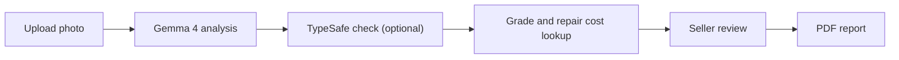

# Technical guide

[Back to the README](../README.md)

## How we use Gemma 4

**Gemma 4 analyzes photos for Disclosure.** It receives a photo and instructions about housing problems, then returns a finding in a format the app can read.

1. **Prepare the image.** [Image processing](../app/images.py) removes metadata and rotates the image if necessary.
2. **Send the photo to Gemma.** [OllamaAnalyzer](../app/inference/ollama_analyzer.py) sends the photo and the instructions to Ollama's with temperature `0` to limit randomness.
3. **Describe the problem, then choose a category.** Prompt **v3.2** asks Gemma for a short title and description. It also asks for the problem type with severity from **1–5**, urgency, confidence, image quality, and whether the category matches the description. The instructions focus on visible damage and distinguish a blurry subject from a clear subject with a blurred background.
4. **Check the response format.** The [instructions and required JSON format](../app/inference/prompts.py) use [27 problem categories plus `unclear`](../assets/defect_taxonomy.json). The app checks category IDs, allowed values, and severity limits, cleans up the title, and limits description length. If the response is invalid, the app tries once more before marking the finding as unclear.
5. **Take a second look when needed.** When TypeSafe checks are enabled, a category that conflicts with Gemma's description can trigger another analysis of the same photo. The new instructions explain the conflict. The revised finding must pass the text check, and its confidence cannot be higher than medium.

All requests to Gemma go through [`DefectAnalyzer`](../app/inference/analyzer.py). So photo analysis is separate from grading and reporting.

### What the AI does and does not do

| Responsibility | How Disclosure handles it |
|---|---|
| Analyze photo| Gemma describes what it sees and suggests a category, severity, urgency, image quality, and confidence level |
| Second guess | If enabled, TypeSafe checks whether the category and severity match Gemma's words and flags cost or legal language |
| Calculate grades | The app applies the severity × urgency rule explained below |
| Look up repair cost ranges | A separate table supplies a low, high, and average price for each problem type and severity. The numbers come from public 2026 cost guides for the DC/MD/VA area, **not contractor quotes, so treat them as planning estimates** |
| Decide what enters the report | The seller confirms each finding and can edit or remove it |

The AI cannot certify that a home is safe or decide what the seller must disclose by law, and TypeSafe only checks text. The AI's confidence level helps guide review; it may be inaccurate.

## TypeSafe verification

Gemma sometimes writes a sentence that disagrees with its own label: "The wooden door trim shows rot near the base" filed under `siding_exterior`. The description is right, the category is wrong, and the grade, repair cost, and Maryland form section all follow the category. TypeSafe's Jev model is there to catch that.

Jev is a small judgment model: give it text and a question, get back a probability. It never sees the photo. The app runs the loop through [`Judge`](../app/inference/judge.py) and [`verify.py`](../app/verify.py); Gemma never calls TypeSafe itself.

1. **Gemma reads the photo** and returns a title, description, category, severity, and confidence.
2. **The app sends Gemma's title and description to Jev**, nothing else. Jev returns three probabilities: does the label match the description, is the severity plausible, and does the text contain a price or legal advice.
3. **Label matches (probability ≥ 0.3):** the finding stays as Gemma wrote it. This is what happens to most findings.
4. **Label contradicts the description (below 0.3):** the app asks Gemma to look at the same photo again with a note, for example "You labelled this `siding_exterior` but described rot in a door frame." The new answer replaces the old one only if Jev agrees with it, and its confidence is capped at medium.
5. **If the second look fails,** Jev picks a category from Gemma's description. The finding moves only if the pick has probability ≥ 0.45 and is not `none_of_these`. Confidence is never raised by a fix.
6. **If that also fails,** the finding keeps Gemma's own title, so the seller sees "Rotted door trim" instead of a wrong category name.
7. **Severity does not fit the description (below 0.3):** confidence drops one step. A finding that drops to low becomes `unclear`.
8. **Price or legal language (probability > 0.7):** the description is replaced with the taxonomy's neutral "look for" text and the title is cleared. A regex also catches `$` followed by a digit, whether or not Jev answered. Prices only ever come from our cost table.

Jev does not write report text. If TypeSafe is down or times out, the app keeps Gemma's finding and records the check as skipped. The seller still reviews and approves every finding.

### Off by default

TypeSafe is **off unless you turn it on**, and the shipped app runs without it. This is deliberate: the app must work with Gemma alone, with no outside service in the path, and no finding text should leave the server unless the operator chose that. Leaving `DISCLOSURE_TYPESAFE_URL` empty keeps every check off.

To enable the checks, add these settings to `.env` and restart the backend. Git ignores `.env`, so keys are never committed.

```dotenv
DISCLOSURE_TYPESAFE_URL=<your TypeSafe API base URL>
TYPESAFE_API_KEY=<your API key>
DISCLOSURE_TYPESAFE_MODEL=jev-latest
DISCLOSURE_JUDGE_VERIFY=1
DISCLOSURE_JUDGE_CLASSIFY=0
```

- `DISCLOSURE_TYPESAFE_URL` and `TYPESAFE_API_KEY` are both required. With either missing, Jev is never called.
- `DISCLOSURE_JUDGE_VERIFY=1` turns on the second opinion above. It costs one Jev call per finding and one extra Gemma call per contradiction.
- `DISCLOSURE_JUDGE_CLASSIFY` lets Jev pick the category outright instead of Gemma (prompt v4). It scored worse on our test photos (10 / 17 against Gemma's 12 / 17), so leave it at `0`.
- The cutoffs are `DISCLOSURE_JUDGE_YES=0.7` and `DISCLOSURE_JUDGE_NO=0.3`; the category pick needs `DISCLOSURE_JUDGE_CONF_MEDIUM=0.45`.

On the 17-photo test set with verify on, Jev flagged the one real self-contradiction (a mold photo labelled `hvac_heating`, label match 0.07), left all seven correct findings alone, and did not catch three wrong labels where Gemma's sentence agreed with its wrong label. A text model cannot fix a description of the wrong thing; that is why the seller's review step exists. The [photo test script](../scripts/run_test_set.py) can also ask Jev whether Gemma's description matches the expected visible details, as a scoring aid.

See [`.env.example`](../.env.example) for every setting, [verification tests](../tests/test_verify.py) for the decision rules, and [experiment notes](../docs/decisions.md#typesafe-text-judge-jev) for model comparisons and how the cutoffs were chosen.

## How the app works



The **website runs on Google Cloud Run**. Its Python backend uses FastAPI and connects to Gemma 4 through Ollama. TypeSafe can check Gemma's text. The app calculates grades and looks up repair costs, and the user confirms details.

## The grading rule

**Risk = severity × urgency.** Severity ranges from **1–5**. Urgency is scored as follows: needs immediate attention **4**, within 30 days **3**, within a year **2**, and appearance only **1**.

| Risk | Letter | Label |
|---|---|---|
| 1–3 | A | Minor |
| 4–6 | B | Moderate |
| 7–10 | C | Serious |
| 11–15 | D | Urgent |
| 16–20 | F | Critical |

The AI's confidence affects how the grade appears: **high** shows one letter, **medium** shows that letter and the next worse grade, and **low** shows no grade and recommends a licensed home inspector.

> The overall grade is the worst grade among findings instead of an average.

## Safety checks

- **Blurry or non-house photo:** ask for a new photo and show no grade when flagged by the model.
- **Low confidence or unclear finding:** no grade, recommends a licensed home inspector.
- **D or F grade:** recommend an assessment by a licensed professional.
- **Invalid AI response:** retry once, then mark the finding unclear.
- **Time limit:** offer a Retry button if analysis takes too long. The default limit is 120 seconds per AI request.
- **Model unavailable:** show a startup message with the command to start Ollama or download the selected model.
- **Seller approval:** include only confirmed findings. In the default app, editing a finding requires the seller to confirm it again.
- **Disclaimer:** show the tool's limits at the start, during review, and on every PDF page.

## Privacy

- **Photo details removed:** before analysis, photos are resized and saved without GPS location, timestamps, or camera information.
- **Cloud analysis:** Gemma has no access to image metadata, and has no way to store photos.
- **TypeSafe receives text only:** Jev receives Gemma's description and title. It does not receive images or email.
- **Session storage:** all information is kept in `localStorage`. “Delete this session” clears it from that browser; downloaded or emailed copies remain separate.
- **Optional email:** email delivery through SMTP.
- **Limited data collection:** the app has no accounts or analytics.

The [network test](../tests/test_no_network.py) checks selected source files for external URLs written directly in the code.

## Measured speed

| Measurement | Recorded result | Scope |
|---|---|---|
| Time to analyze one photo | **7.4 seconds median** (middle result), 5.4–10.2 seconds range | `gemma4:e4b`, prompt v3.2, 17-photo test; does not include TypeSafe |
| Photos processed with the GPU model already loaded | **17 photos in 62 seconds**, **16.3 photos/minute** |

See [full test results](../docs/test-results.md) and [Cloud Run measurements](../docs/gate0.md#cloud-run-gpu-us-east4-gemma4e4b) for details.

## How we test changes with photos

We keep **17 example photos with expected answers** and run them through the AI after changes to ensure the results stay consistent.

For example:

- A roof-damage photo should still be categorized as roof damage.
- A cat photo should still be recognized as something other than a house.
- A blurry photo should still prompt a retake rather than receive a grade.

The [photo list](../assets/test_photos/test_photos.csv) includes visible problems, blurry photos, pictures unrelated to housing, and an undamaged room. The [test script](../scripts/run_test_set.py) records the expected answer, the actual answer, and how long each photo takes. When configured, TypeSafe also checks whether Gemma's description matches the expected visible details.

Results are saved in a [comparison report](../docs/test-results.md), so we can compare versions of the AI instructions using the same examples. These checks test the photo analysis answers. Live checks and second looks have separate [automated tests](../tests/test_verify.py) and [experiment notes](../docs/decisions.md#typesafe-text-judge-jev). All example photos have licenses that allow reuse, with [credits recorded](../assets/test_photos/ATTRIBUTION.md).

## Local development

To use Disclosure, open the [hosted website](https://disclosure-app-jyruvsvlxa-uk.a.run.app/). The commands below are for developers running a separate copy on their own computer. `localhost` addresses in this section refer to that local copy.

### Windows

Requires Python 3.11+, Git, and [Ollama](https://ollama.com/download). Start Ollama before analyzing photos.

```powershell
git clone https://github.com/ben-robles/disclosure
cd disclosure
py -3.11 -m venv .venv
.\.venv\Scripts\python -m pip install -r requirements.txt
ollama pull gemma4:e4b
$env:DISCLOSURE_MODEL = "gemma4:e4b"
.\run.ps1
```

The backend API is available at **http://localhost:8000**. Add `-Lan` to the final command to use the app from a phone on the same trusted Wi-Fi network.

### macOS / Linux

From the cloned repository, using Python 3.11+:

```sh
python3 -m venv .venv
.venv/bin/python -m pip install -r requirements.txt
ollama pull gemma4:e4b
DISCLOSURE_MODEL=gemma4:e4b .venv/bin/python -m uvicorn app.main:create_app --factory --host 127.0.0.1 --port 8000
```

### Try the workflow without a model

```sh
.venv/bin/python -m tests.dev_server
```

On Windows, use `.\.venv\Scripts\python -m tests.dev_server`. This runs the real API on **http://localhost:8001** with preset AI responses, for API and PDF checks. To try the React interface without a model, use `VITE_MOCK_ANALYZER=1` (below).

### React interface

The Python backend serves the API only. The web app is the React interface in `frontend/`: start the Python backend, then run `npm install` and `npm run dev` from `frontend/`.

Vite forwards `/api` requests to port 8000. The React interface stores sessions in browser `localStorage`, queues photos for analysis, and creates PDFs. Use `VITE_MOCK_ANALYZER=1` for preset AI responses. The backend's TypeSafe checks apply to every analysis.

### Configuration

Set environment variables before starting the backend, or add them to `.env`, which Git ignores. Variables already set in the running environment override values in `.env`.

| Setting | Purpose |
|---|---|
| `DISCLOSURE_MODEL` | Name and version of a downloaded model, such as `gemma4:e4b` |
| `DISCLOSURE_OLLAMA_URL` | Address of local Ollama, or `http://localhost:9090` when connecting through a Cloud Run proxy that handles authentication |
| `DISCLOSURE_OLLAMA_TOKEN` | Optional Google Cloud authentication token for a direct connection; leave empty when using the proxy |
| `DISCLOSURE_WORKERS` | Number of backend workers; match Ollama's `OLLAMA_NUM_PARALLEL` |
| `DISCLOSURE_KEEP_ALIVE` | Keep the model loaded between requests; default `30m` |
| `DISCLOSURE_TIMEOUT_S` | Time limit per AI request; default `120` seconds |
| `DISCLOSURE_DATA_DIR` | Backend storage directory; default `data/` |

For TypeSafe, use the [verification settings above](#typesafe-verification). To enable email delivery, fill in the SMTP settings in [`.env.example`](../.env.example) and save it as `.env`.

## Deployment

**Hosted website:** Disclosure is available at [disclosure-app-jyruvsvlxa-uk.a.run.app](https://disclosure-app-jyruvsvlxa-uk.a.run.app/) on Google Cloud Run. Users open the website directly from their browser.

**AI service:** Ollama runs Gemma 4 on a separate private Cloud Run service with an NVIDIA L4 GPU. The deployment includes the model files and settings for how many requests can run at once and how many server instances can start.

**Local development:** developers can run the app with Ollama on their own computer or connect to the cloud model through a proxy that handles authentication.

The [model-service deployment guide](../cloud/README.md) explains what you need, how to deploy the GPU service, how to keep it ready for a demo, how to adjust capacity, and how to shut it down.

## Development and testing

```sh
.venv/bin/python -m pytest tests
.venv/bin/python scripts/run_test_set.py
.venv/bin/python scripts/run_test_set.py --no-judge
```

On Windows, use `.\.venv\Scripts\python`. Automated tests use fake model responses to check response handling, grading, category mapping, photo queues, API requests, and TypeSafe checks. The photo test script uses the configured Gemma service and optional TypeSafe scoring.

Photo results are grouped by prompt version in `docs/test-results.md`. Detailed JSON results for each photo are saved under `data/eval/<run>/`. See [the model and hardware measurement guide](../docs/gate0.md) for response timing and speed comparisons between one and four workers.

Keep model requests in `DefectAnalyzer` and text checks in `Judge`. Keep grading rules, cost data, and rules for matching locations to disclosure requirements separate from AI prompts so each can be updated and tested on its own.
